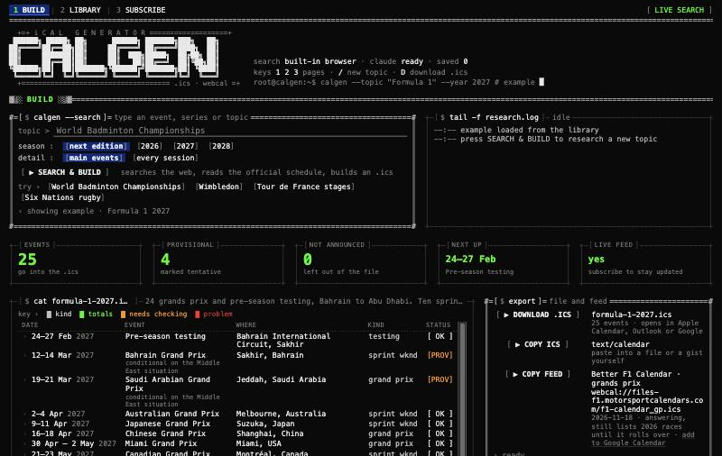

<div align="center">
  <h1>Calendar Generator</h1>
  <p><b>Turn any event schedule on the web into an .ics calendar.</b></p>


[](LICENSE)

</div>

<p align="center">
  
</p>

Type an event, series or topic, such as *World Badminton Championships* or *Formula 1*. Calendar Generator searches the web, reads the organiser's published schedule and turns the dates into a calendar file you can open in Apple Calendar, Outlook or Google Calendar. If the search finds a public calendar feed, you also get a link to subscribe to it so the dates stay up to date.

It's a single HTML page that runs as a [Claude Artifact](https://claude.ai). Claude does the research, and the page shows you every search and every page it reads.

## Install

Requires a Claude account and the Claude desktop app (macOS or Windows) for live search.

1. Download [`calendar-generator.html`](calendar-generator.html).
2. In Claude Code (in the Claude desktop app), ask Claude to publish it as an Artifact with these capabilities:

   ```json
   {
     "sample": {},
     "mcp": { "servers": [{ "server": "host:claude_browser", "tools": ["navigate", "get_page_text"] }] },
     "downloads": true,
     "db": {},
     "user": {}
   }
   ```

3. Open the Artifact in the **Claude desktop app** and press **SEARCH & BUILD**.

Live web search only works in the desktop app, because it uses the app's built-in browser. Anywhere else the page answers from Claude's memory and marks those results in orange.

> [!NOTE]
> If you open the HTML file straight in a web browser, you can see the built-in examples, but searching, downloading and saving are switched off.

## Features

- **Searches the real schedule.** It runs a web search, reads the official pages and returns events with their source links. It doesn't guess dates.
- **Says when dates aren't out yet.** An edition with no announced dates shows as `[ TBA ]` and nothing is added to the file. Provisional dates are marked `[PROV]` and saved as tentative events.
- **Downloads an .ics file.** Multi-day events become all-day events. Sessions with a published start time are saved in UTC.
- **Finds live feeds to subscribe to.** If a public `.ics` feed exists, you get the `webcal://` address and an "add to Google Calendar" link.
- **Updates instead of making copies.** Each event keeps the same ID between builds, so when you open a rebuilt file, Apple Calendar and Outlook update the events you already have instead of adding new ones.
- **Main events or every session.** Choose one entry per event or round, or every session, with start times when the organiser publishes them.
- **Library.** Save the calendars you build and open them again later. Formula 1 2027 and MotoGP 2027 are built in as examples.
- **Shows its working.** A research log lists every search and page as it happens. A sources panel lists where the dates came from and any caveats.

## How to use it

1. Type a topic, or pick one of the **try ›** suggestions.
2. Choose a season (**next edition**, or a year) and the level of detail.
3. Press **SEARCH & BUILD**. A run usually takes 30 to 90 seconds.
4. Check the table, then press **DOWNLOAD .ICS**, **COPY FEED** or **SAVE**.

| Key | Action |
|---|---|
| <kbd>1</kbd> <kbd>2</kbd> <kbd>3</kbd> | Switch between Build, Library and Subscribe |
| <kbd>/</kbd> | Start a new topic |
| <kbd>D</kbd> | Download the current calendar as .ics |

## FAQ

<details>
<summary><b>Why can't I always subscribe instead of downloading?</b></summary>

A calendar app can only subscribe to a public web address. Artifacts are private, so the page can't host a feed itself. When the organiser or a calendar site publishes a feed, Calendar Generator gives you that address. Otherwise you get a file. To turn a file into a subscription, put it somewhere public (a gist's raw link or a web host) and subscribe to that address.
</details>

<details>
<summary><b>Does it cost anything?</b></summary>

Each search uses your own Claude usage. The first time you search, Claude asks you to allow it.
</details>

<details>
<summary><b>How accurate are the dates?</b></summary>

They're only as good as the pages the search finds. Every event links to its source, and anything provisional or unannounced is marked. Check the official site before you book travel.
</details>

## Licence

MIT, see [LICENSE](LICENSE).

---

Made by [AJ](https://github.com/ajd1776) · More work on Instagram: [@ajd.gfx](https://www.instagram.com/ajd.gfx/)
